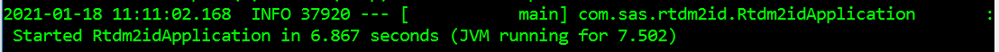
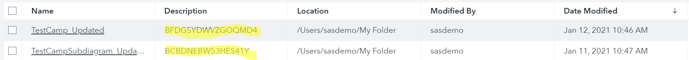

# RTDM to ID Migration

- [RTDM to ID Migration](#rtdm-to-id-migration)
  - [Overview](#overview)
    - [Prerequisites](#prerequisites)
    - [Installation](#installation)
  - [Getting Started](#getting-started)
  - [Running](#running)
    - [Examples](#examples)
    - [Configuration](#configuration)
    - [Capabilities](#capabilities)
  - [Support](#support)
    - [SAS Communities](#sas-communities)
    - [SAS Documentation](#sas-documentation)
    - [GitHub Issues](#github-issues)
  - [Contributing](#contributing)
  - [License](#license)

## Overview
Tool to migrate campaigns from SAS Real-Time Decision Manager (RTDM) to SAS Intelligent Decisioning (ID).

### Prerequisites
Java 21 is required to build and run the service. Set `JAVA_HOME` to a JDK 21 installation and ensure its `bin` directory is on `PATH`.

Campaigns from RTDM need to be extracted using SAS Customer Intelligence Integration Utilities.
This step must be performed before running the migration tool.

[SAS Customer Intelligence Integration Utilities documentation](https://documentation.sas.com/?activeCdc=cicmncdc&cdcId=cicdc&cdcVersion=6.6&docsetId=ciintutilug&docsetTarget=titlepage.htm)


### Installation
Download this project and build using provided Maven pom.xml file.

```shell script
mvn clean install
```
The Maven wrappers can also be used: `./mvnw clean install` on Linux or `./mvnw.cmd clean install` on Windows.

This will generate a jar file under the \target folder.

## Getting Started
Migrating campaigns from RTDM to ID is a 3-step process.
* Extract campaigns from RTDM using SAS Customer Intelligence Integration Utilities. This creates an extract XML file.
* Start rtdm-migrate-to-id tool
* Issue REST requests to rtdm-migrate-to-id tool using the extract XML file as input.

## Running
Run the migration tool from a command/shell window.

```shell script
java -jar rtdm-migrate-to-id-0.15.1.jar

or
# if port 8080 already in use
java -Dserver.port=8086 -jar rtdm-migrate-to-id-0.15.1.jar
```

This row inside command/shell will tell you that service successfully started


RTDM Subdiagrams must be migrated before migrating parent diagram.

### Examples
Authenticate with SAS Viya to get an authorization token.
* https://developer.sas.com/apis/rest/#authentication-to-sas-viya
* https://github.com/sassoftware/devsascom-rest-api-samples/blob/master/CoreServices/sasLogon.md

Once authenticated user can POST requests.

```shell script
POST: localhost:8080/api/rtdm2id/create-diagram?baseIp={{ID environment}}&login={username}&password={password}&protocol={protocol}&parentFolderUri={parentFolderUri}&useCrossBranchLinks={useCrossBranchLinks}
Authorization: Bearer {{token}}
Content-Type: application/xml
Body: Extract XML generated from SAS Customer Intelligence Integration Utilities

Example Body: extract/extracted_campaign.xml
```
The parameter protocol is optional. The default value is "http" if not provided. If the target environment is using HTTPS for secure online transactions then protocol must be provided with a value of "https".

Use `protocol=https` when transmitting credentials or tokens. HTTPS connections validate the server certificate and hostname using the JVM truststore. For an internal or self-signed Viya certificate, trust the issuing CA in the JVM truststore or configure a dedicated truststore with `javax.net.ssl.trustStore` and the appropriate runtime truststore settings. Untrusted certificates are no longer accepted automatically.

The parameter parentFolderUri is optional. The default value is /folders/folders/@myFolder if not provided.

The parameter useCrossBranchLinks is optional. The default value is "true".
The use of cross-branch link nodes in the migration tool is an experimental feature. This feature is enabled by default. Cross-branch links will be created in the migrated Decision if the RTDM campaign contains a node with multiple input nodes. If the migration tool generates an error related to cross-branch links then set this parameter to "false".

Calculated RuleSet consolidation is enabled by default to reduce Decision nodes: the calculated items an RTDM node uses are merged into one RuleSet placed before that node. The RuleSet computes the items the node references, and the calculated items those depend on, in dependency order with one assignment each. Like RTDM, which evaluates a calculated item where it is used, every node computes the items it uses itself, so an item used by several nodes is computed in each of them. No RuleSet is created for an individual calculated item. The process-input and extraction RuleSets remain separate.

Disable consolidation when starting the service with `--rtdm2id.consolidate-calculated-rulesets=false`, or set `rtdm2id.consolidate-calculated-rulesets=false` in application configuration. Each calculated item then gets its own RuleSet and step, inserted once, before the first node that uses it.

Merged RuleSet names (`Calculated_<node id>_<fingerprint>`) include a content fingerprint. An existing RuleSet with that name is checked for a complete signature and the same ordered actions before reuse. An empty, partial, or incompatible one stops the migration rather than being silently reused or overwritten. As with other migration errors, the endpoint still responds with HTTP 201 and the error message in the response body, and RuleSets created earlier in that run are left in place. Inspect or delete the reported RuleSet before retrying. Existing Decisions are still not overwritten.

To register a new OAuth client on the target Viya environment using a Consul token:

```shell script
POST: localhost:8080/api/rtdm2id/register-client?baseIp={{ID environment}}&protocol={protocol}&consulToken={consulToken}&clientId={clientId}&clientSecret={clientSecret}
```

### Configuration

The following properties can be set in `application.properties` or on the command line (for example `--rtdm2id.http.read-timeout=20m`):

| Property | Default | Description |
|---|---|---|
| `rtdm2id.http.connect-timeout` | `30s` | Connect timeout for REST calls to Viya. |
| `rtdm2id.http.read-timeout` | `10m` | Read timeout for REST calls to Viya. Some Viya calls can be slow, so keep this generous. |
| `rtdm2id.cors.allowed-origins` | empty | Comma-separated list of browser origins allowed to call the API cross-origin. Empty means no cross-origin access; command-line and server-side clients are not affected. |
| `rtdm2id.debug.write-decision-json` | `false` | Write the generated Decision JSON to a file before posting it to Viya. Failures to write the file are logged as warnings and do not fail the migration. |
| `rtdm2id.debug.decision-json-path` | `decision.json` | File used when `rtdm2id.debug.write-decision-json` is enabled, relative to the working directory unless absolute. |

OAuth tokens are cached per Viya host, protocol, user and password and are refreshed shortly before they expire.

### Capabilities

* Creation of DS2 Node process in ID from RTDM DS2 Process
* Creation of SQL Node process in ID from RTDM Data Process
* Creation of Decision input/output variables in ID from RTDM event variables
* Creation of Assignment Rule Set in ID from RTDM Reply Node
* Creation of Assignment Rule Set in ID from RTDM calculated variables
* Conversion of RTDM Cross-Table nodes to ID segmentation trees with matrices and local value lists for discrete values, numeric ranges, whole-date ranges, and day/time criteria. Day/time criteria use a preceding RuleSet to derive calendar-day numbers and seconds since midnight from datetime inputs; these internal values feed numeric matrix ranges. Missing values and character `LIKE` patterns use boolean operators; remaining cells use matrices.
  Row-only and column-only Cross-Table nodes become boolean decision trees without a synthetic input for the absent axis. Row-only tables require one result cell per row; column-only tables require one row with one result cell per column. Conditions, remainder criteria, and output defaults are preserved; malformed table dimensions and nodes with neither axis are rejected.
* RTDM Subdiagrams must be migrated before migrating parent diagram
  

## Support

### SAS Communities
Ask questions on the [Decisioning Community Web Site](https://communities.sas.com/t5/Decisioning/bd-p/decisioning).

### SAS Documentation

[SAS Customer Intelligence Integration Utilities](https://documentation.sas.com/?activeCdc=cicmncdc&cdcId=cicdc&cdcVersion=6.6&docsetId=ciintutilug&docsetTarget=titlepage.htm)

[Authentication to SAS Viya](https://developer.sas.com/apis/rest/#authentication-to-sas-viya)

[SAS Logon API](https://github.com/sassoftware/devsascom-rest-api-samples/blob/master/CoreServices/sasLogon.md)

### GitHub Issues

See the [SUPPORT.md](SUPPORT.md) file for information on how to open an issue against this repository.

## Contributing
> We welcome your contributions! Please read [CONTRIBUTING.md](CONTRIBUTING.md) for details on how to submit contributions to this project.

## License
> This project is licensed under the [Apache 2.0 License](LICENSE).